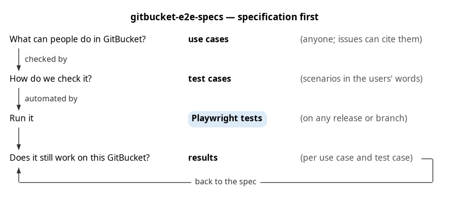

gitbucket-e2e-specs
===================

[](https://github.com/aadrian/gitbucket-e2e-specs/actions/workflows/e2e.yml)

Use cases, test cases and their browser tests (Playwright) for [GitBucket](https://github.com/gitbucket/gitbucket)
and its four bundled plugins (`notifications`, `gist`, `emoji`, `pages`).

- `core/`, `plugins/<pluginId>/`: one folder per scope, each with `use-cases.md` (`<scope>:UC-...`),
  `test-cases.md` (`<scope>:T-...`) and the specs per stage (`setup/`, `smoke/`, ...).
- `docs/e2e-plan.md`: scope, IDs, and how use cases, test cases and tests fit together.
- `docs/development.md`: the concept and how to test a GitBucket pull request, in two diagrams.

Status: started. Test accounts, setup and the first test cases (`core:T-200` to `core:T-250`: deleting and
reverting from GitBucket's pages); the plugin folders are placeholders.

Run
---

Needs Node 20+, the `gpg` command (core:T-200 makes a GPG key per run) and a running GitBucket that may be changed
(a throwaway or test instance).

```bash
npm install
npx playwright install firefox           # once per Playwright version; chromium for E2E_BROWSER=chromium
export E2E_BASE_URL=http://localhost:8080/   # default; include the context path if there is one
npm run e2e                              # setup, then smoke and flows
npx playwright test --project=flows      # the test cases (setup runs first)
npx playwright test --grep @gist         # one scope only (@core, @gist, ...)
npm run report                           # HTML report of the last run
```

| Variable | Default | Meaning |
|---|---|---|
| `E2E_BASE_URL` | `http://localhost:8080/` | instance under test |
| `E2E_ALLOW_REMOTE` | – | `1` allows a host other than localhost / `*.local` / `*.test` / `*.localhost` |
| `E2E_IGNORE_HTTPS_ERRORS` | – | `true` for self-signed or local CA certificates |
| `E2E_BROWSER` | `firefox` | `firefox` or `chromium` |
| `E2E_ROOT_PASSWORD` | `root` | password of `root` when it isn't the initial one |
| `E2E_PASSWORD` | `e2e-password` | password of the test accounts setup creates |
| `E2E_RUN` | new per run | run ID in the names of the data a run creates; set it to resume a run |

Results, traces, screenshots and videos: `results/`. Stored sessions: `.auth/`. Both git-ignored.

A throwaway instance from a GitBucket war (Java 17+), with an empty home:

```bash
scripts/get-gitbucket.sh 4.48.0 gitbucket.war                    # a release
scripts/get-gitbucket.sh <owner>/gitbucket@<branch> gitbucket.war  # or a branch, tag or commit, built from source
scripts/start-gitbucket.sh gitbucket.war 8080 /tmp/gb-e2e-home   # waits until it answers; stop: kill "$(cat /tmp/gb-e2e-home.pid)"
```

The stored sessions in `.auth/` belong to one instance; setup writes them again at the start of every run.

CI
--

`.github/workflows/e2e.yml` runs the suite on every push and pull request that changes more than Markdown files or
the license, in Firefox (Chromium: one line in the matrix, commented out for now), against a new GitBucket 4.48.0.
On failure the HTML report and the GitBucket log are uploaded as an artifact. The run's summary page names the
GitBucket under test and lists the results (counts, failed tests, all tests).

"Run workflow" (`workflow_dispatch`) has one input, `gitbucket`: a release (`4.48.0`) or a branch, tag or commit of
any GitBucket repository (`owner/repo@ref`), which `scripts/get-gitbucket.sh` builds with `./sbt executable` (a few
minutes). The run is named `e2e on <gitbucket>` and its summary names the commit, so its link can go into a GitBucket
pull request as proof:

```sh
gh workflow run e2e.yml -R aadrian/gitbucket-e2e-specs -f gitbucket=<owner>/gitbucket@<branch>
```

The ref is resolved when the run starts; later pushes to the branch need a new run.

The jobs run in Playwright's Docker image (`mcr.microsoft.com/playwright:v<version>-noble`), which has the browsers
preinstalled. Its tag must match the `@playwright/test` version in `package.json`: when upgrading Playwright,
change both; the workflow fails with a message when they differ.

Locally with [act](https://github.com/nektos/act): `act push`; a branch:
`act workflow_dispatch --input gitbucket=gitbucket/gitbucket@master -s GITHUB_TOKEN="$(gh auth token)"`.

Layout
------

```sh
core/                       # GitBucket itself: use cases, test cases, specs per stage
plugins/                    # one folder per bundled plugin, laid out like core/
docs/                       # e2e-plan.md (scope, IDs, structure), development.md (concept)
playwright.config.js        # projects per stage (setup → smoke → ...); browser, target
lib/
├── target.js               # instance under test; refuses non-local hosts by default
├── personas.js             # test accounts: names, account types, memberships
├── auth.js                 # sign in / out, stored session per persona
├── api.js                  # REST API (api/v3) as a persona, to check results of UI steps
├── plugins.js              # installed plugins; skips a plugin's tests when it is missing
├── run.js                  # run ID and names of a run's data
├── ui.js                   # confirm dialogs, flash messages, error pages
├── keys.js                 # fresh SSH and GPG public keys
└── repo.js, webhooks.js    # steps several test cases share
scripts/
├── get-gitbucket.sh        # the war to test: a release, or a branch built from source
├── start-gitbucket.sh      # throwaway instance from a war
└── ci-summary.js           # CI: results/results.json as the run's summary page
.github/workflows/e2e.yml   # CI: Firefox (Chromium commented out) against a new instance
```

Concept
-------

Specification first: use cases and test cases in plain words, the Playwright tests automate them, and the results
report back to the spec (`docs/development.md`).



License
-------

Apache License 2.0, like GitBucket (`LICENSE`).
