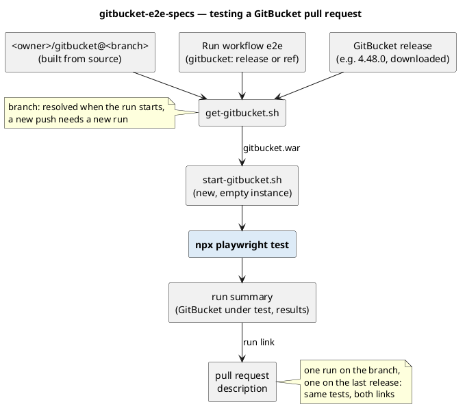

Development
===========

Concept
-------

- Specification first: use cases say what each kind of account can do in GitBucket, test cases how that is
  checked, both in plain words. The Playwright tests automate the test cases; results are named by test case ID.
- The spec depends neither on a GitBucket version nor on the test tool: the same tests run against any release or
  branch.
- Scope, IDs and formats: `e2e-plan.md`. Running the tests, locally and in CI: `../README.md`.


Testing a GitBucket pull request
--------------------------------

Run the workflow on the pull request's branch and on the last release, then put both run links into the pull
request's description (example: gitbucket/gitbucket#4166):

```sh
gh workflow run e2e.yml -R aadrian/gitbucket-e2e-specs -f gitbucket=<owner>/gitbucket@<branch>
gh workflow run e2e.yml -R aadrian/gitbucket-e2e-specs -f gitbucket=4.48.0
```



Diagrams
--------

Source and PNG are both committed; after changing a source, render its PNG again (in `docs/`):

- `use-from-a-pull-request.puml`: PlantUML, style in `diagram-style.iuml`.
  `java -jar plantuml.jar use-from-a-pull-request.puml`
- `specs-idea.dot`: Graphviz, every element at a fixed position. `neato -Tpng -o specs-idea.png specs-idea.dot`

Both use the Noto Sans font.
